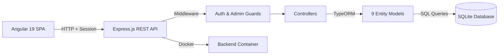
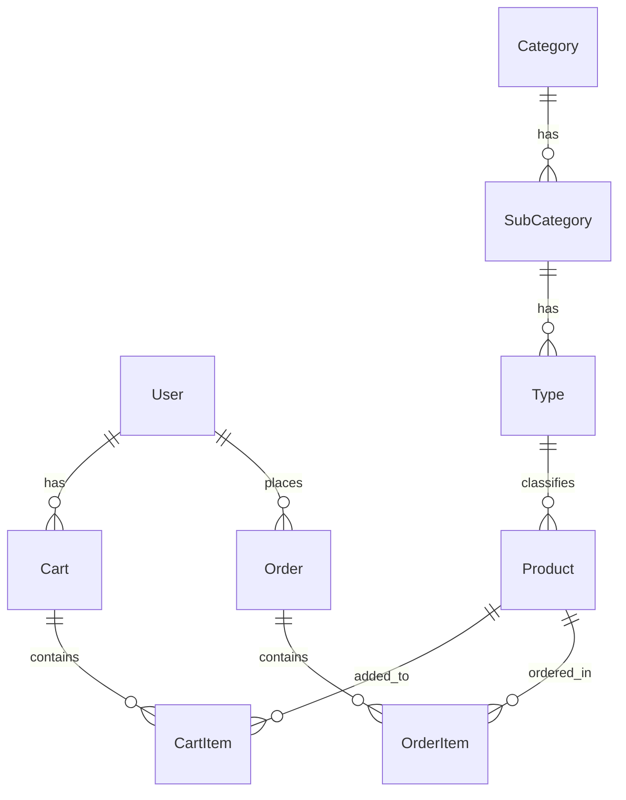

# 🛒 E-Commerce – Full-Stack Angular & Node.js Platform


A production-grade, full-stack e-commerce platform built with **Angular 19, Node.js, Express.js, TypeORM, and SQLite**. This project demonstrates modern full-stack architecture, a normalized 9-entity relational schema, secure REST API design, and containerized backend deployment.

## 📖 Table of Contents
- [Features](#-key-features)
- [Architecture](#-system-architecture)
- [Tech Stack](#-tech-stack)
- [Project Structure](#-project-structure)
- [Getting Started](#-getting-started)
- [Environment Variables](#-environment-variables)
- [API Reference](#-api-reference)
- [Database Schema](#-database-schema)
- [Deployment](#-deployment)
- [Contributing](#-contributing)

## 🚀 Key Features

- **Full-Stack Monorepo:** Separate `backend` and `frontend` directories for clean separation of concerns.
- **9-Entity Relational Schema:** A deeply normalized data model with `User`, `Product`, `Category`, `SubCategory`, `Type`, `Cart`, `CartItem`, `Order`, and `OrderItem` entities[reference:2].
- **Secure Authentication & Authorization:** Session-based auth with middleware for route protection, user profile management, and admin-only routes.
- **Complete E-Commerce Flow:** End-to-end shopping experience including product browsing, cart management, order placement, and order history.
- **Admin Dashboard Capabilities:** Admin routes for user management (lock/unlock users), order oversight, and product/catalog management[reference:3].
- **TypeORM Migrations:** Production-ready database migrations for schema versioning and safe deployments[reference:4].
- **Containerized Backend:** Dockerfile for the Node.js backend, enabling reproducible deployments[reference:5].
- **Responsive Angular Frontend:** Modern Angular 19 standalone components with a responsive UI and loading states[reference:6].

## 🏗️ System Architecture

The application follows a classic **decoupled client-server architecture**:

1. **Frontend (Angular 19):** Standalone components, services for API communication, and routing for a SPA experience.
2. **Backend (Node.js + Express):** RESTful API server with controllers, routes, middlewares, and TypeORM data access.
3. **Data Access (TypeORM):** Entity models with decorators, migrations for schema versioning, and a SQLite database for lightweight, file-based persistence.
4. **Deployment:** Backend containerized with Docker; frontend deployable to any static host (Vercel, Netlify, or Angular universal).



## 🛠️ Tech Stack

| Layer | Technology | Purpose |
| :--- | :--- | :--- |
| **Frontend** | Angular 19.2 | SPA framework with standalone components |
| **Backend** | Node.js + Express.js | REST API server |
| **Language** | TypeScript | End-to-end type safety |
| **ORM** | TypeORM | Entity mapping and migrations |
| **Database** | SQLite | Lightweight relational database |
| **Auth** | Session-based with middleware | Secure route protection |
| **DevOps** | Docker | Backend containerization |
| **Testing** | Karma (frontend) | Unit testing |

## 📂 Project Structure

```text
E-Commerce/
├── backend/
│   ├── src/
│   │   ├── controllers/         # Route handlers and business logic
│   │   ├── entities/           # TypeORM entity models (9 entities)
│   │   │   ├── User.ts
│   │   │   ├── Product.ts
│   │   │   ├── Category.ts
│   │   │   ├── SubCateory.ts
│   │   │   ├── Type.ts
│   │   │   ├── Cart.ts
│   │   │   ├── CartItem.ts
│   │   │   ├── Order.ts
│   │   │   └── OrderItem.ts
│   │   ├── middlewares/        # Auth guards and request middleware
│   │   ├── migrations/         # TypeORM migration files
│   │   ├── routes/             # API route definitions
│   │   │   ├── AdminRoutes.ts
│   │   │   ├── AuthRoutes.ts
│   │   │   ├── CartRoutes.ts
│   │   │   ├── OrderRoutes.ts
│   │   │   └── ProductRoutes.ts
│   │   ├── utils/              # Helper functions
│   │   ├── data-source.ts      # TypeORM data source configuration
│   │   └── index.ts            # Express app entry point
│   ├── Dockerfile              # Backend container definition
│   ├── .dockerignore
│   ├── package.json
│   └── tsconfig.json
├── frontend/
│   ├── src/                    # Angular application source
│   ├── public/                 # Static assets
│   ├── angular.json
│   ├── package.json
│   └── README.md               # Angular CLI default README
├── .gitignore
└── README.md
```

## 🚦 Getting Started

### Prerequisites
- **Node.js 20+** installed.
- **Angular CLI 19+** installed globally (`npm install -g @angular/cli`).
- **Docker** (optional, for containerized backend).

### Running Locally

**1. Clone the repository**
```bash
git clone https://github.com/Octar123/E-Commerce.git
cd E-Commerce
```

**2. Backend Setup**
```bash
cd backend
npm install
```

Create a `.env` file in the `backend` directory (see [Environment Variables](#-environment-variables)).

Run TypeORM migrations:
```bash
npm run typeorm migration:run
```

Start the backend server:
```bash
npm run dev
```
*The API will be available at `http://localhost:3000` (or the port specified in your `.env`).*

**3. Frontend Setup**
Open a new terminal:
```bash
cd frontend
npm install
ng serve
```
*The Angular app will be available at `http://localhost:4200/`.*

## 🔐 Environment Variables

Create a `.env` file in the `backend` directory with the following variables:

| Variable | Description | Example |
| :--- | :--- | :--- |
| `PORT` | Backend server port | `3000` |
| `SESSION_SECRET` | Secret for session encryption | `your-secret-key` |
| `DB_PATH` | Path to the SQLite database file | `./database.sqlite` |
| `FRONTEND_URL` | Allowed CORS origin | `http://localhost:4200` |

> **Note:** Never commit your `.env` file. It is already included in `.gitignore`.

## 📚 API Reference

Here is a summary of the core RESTful endpoints across all route modules.

### Authentication APIs (`AuthRoutes.ts`)
| Method | Endpoint | Description | Auth Required |
| :--- | :--- | :--- | :--- |
| `POST` | `/api/auth/register` | Register a new user | No |
| `POST` | `/api/auth/login` | Authenticate and create session | No |
| `POST` | `/api/auth/logout` | Destroy session | Yes |
| `GET` | `/api/auth/profile` | Get current user profile | Yes |
| `PUT` | `/api/auth/profile` | Update user profile | Yes |
| `PUT` | `/api/auth/password` | Change password | Yes |

### Product APIs (`ProductRoutes.ts`)
| Method | Endpoint | Description | Auth Required |
| :--- | :--- | :--- | :--- |
| `GET` | `/api/products` | List all products with search/filter | No |
| `GET` | `/api/products/:id` | Get product details | No |

### Cart APIs (`CartRoutes.ts`)
| Method | Endpoint | Description | Auth Required |
| :--- | :--- | :--- | :--- |
| `GET` | `/api/cart` | Get current user's cart | Yes |
| `POST` | `/api/cart` | Add item to cart | Yes |
| `PUT` | `/api/cart/:itemId` | Update cart item quantity | Yes |
| `DELETE` | `/api/cart/:itemId` | Remove item from cart | Yes |
| `GET` | `/api/cart/total` | Get cart total | Yes |

### Order APIs (`OrderRoutes.ts`)
| Method | Endpoint | Description | Auth Required |
| :--- | :--- | :--- | :--- |
| `POST` | `/api/orders` | Place a new order | Yes |
| `GET` | `/api/orders` | Get user's order history | Yes |
| `GET` | `/api/orders/:id` | Get order details | Yes |

### Admin APIs (`AdminRoutes.ts`)
| Method | Endpoint | Description | Auth Required |
| :--- | :--- | :--- | :--- |
| `GET` | `/api/admin/users` | List all users | Yes (Admin) |
| `PUT` | `/api/admin/users/:id/lock` | Lock a user account | Yes (Admin) |
| `PUT` | `/api/admin/users/:id/unlock` | Unlock a user account | Yes (Admin) |
| `GET` | `/api/admin/orders` | List all orders | Yes (Admin) |
| `GET` | `/api/admin/orders/:id` | Get order detail | Yes (Admin) |

## 🗄️ Database Schema

The core TypeORM entities modeled in SQLite:

- **`User`**: Stores authentication credentials, profile info, and role (user/admin).
- **`Product`**: Core product catalog with pricing, stock, and relationships to taxonomy.
- **`Category`**, **`SubCategory`**, **`Type`**: A three-level taxonomy for product classification.
- **`Cart`**: One-to-one relationship with a user; holds `CartItem`s.
- **`CartItem`**: Links a product to a cart with quantity; cascades on product deletion.
- **`Order`**: Represents a placed order with status and total.
- **`OrderItem`**: Line items within an order, linking to products and quantities.



## 🚀 Deployment

### Backend (Docker)

Build and run the backend container:
```bash
cd backend
docker build -t ecommerce-backend .
docker run -p 3000:3000 --env-file .env ecommerce-backend
```

### Frontend (Static Hosting)

Build the Angular app for production:
```bash
cd frontend
ng build --configuration production
```
Deploy the `dist/` folder to **Vercel**, **Netlify**, or any static hosting provider.

> **Important:** Update the `FRONTEND_URL` in the backend `.env` to match your deployed frontend URL for CORS.

## 🤝 Contributing

Contributions, issues, and feature requests are welcome!

1. Fork the Project
2. Create your Feature Branch (`git checkout -b feature/AmazingFeature`)
3. Commit your Changes (`git commit -m 'Add some AmazingFeature'`)
4. Push to the Branch (`git push origin feature/AmazingFeature`)
5. Open a Pull Request

## 📄 License

Distributed under the MIT License. See `LICENSE` for more information.

---
*Built with ❤️ by [Ranjan Mali](https://github.com/Octar123)*
